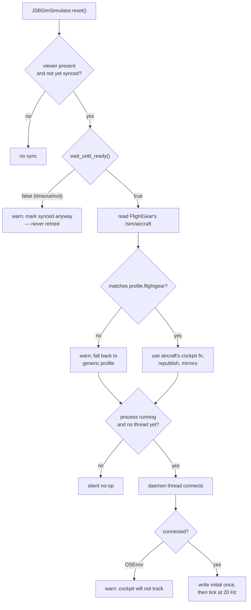
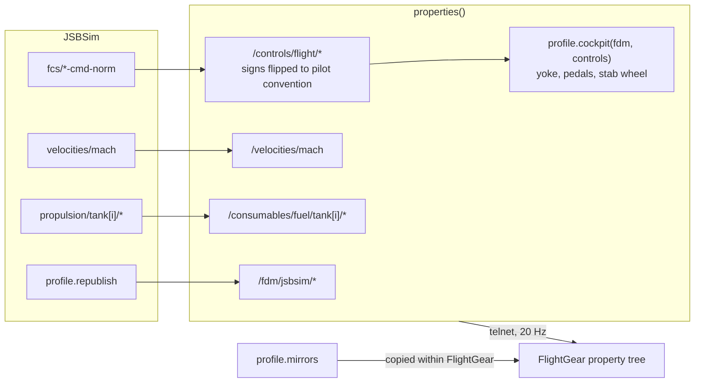

# CockpitSync

FlightGear runs as a viewer only (`--fdm=null`), fed native-FDM frames over UDP
from JSBSim. That disables everything the aircraft's own JSBSim configuration
would compute, so FlightGear knows only what the packet carries: position,
orientation, control deflections, a little engine state.

`CockpitSync` supplies the rest — panel power, pressure instruments, fuel, mach,
yoke animation — over FlightGear's telnet property server.
[`cockpit.py`](../packages/aero-gym/src/aero_gym/simulators/jsbsim/cockpit.py)
decides *what* to write;
[`flightgear.py`](../packages/aero-gym/src/aero_gym/simulators/jsbsim/flightgear.py)
owns the thread and the connection.

## Two rules

1. **Never write a property the packet already carries** (airspeed, position,
   attitude) — FlightGear overwrites it every frame and the channels fight.
   Mach *is* written: it is absent from the packet, and zero flattens the pitot
   model.
2. **State the user should stay free to change is written once on connect**
   (`initial_properties()`), not every tick — otherwise the master switches
   become unclickable.

## Setup, and the four guards

1. **Aircraft identity** (`cockpit.py:45`) — `CockpitSync` is keyed on the
   **JSBSim model**, but checked against what FlightGear reports it loaded. The
   strings differ: JSBSim's `737` is FlightGear's `737-300`. On mismatch it warns
   and drops to the generic profile, since a 737's panel properties mean nothing
   in a Cessna's cockpit.
2. **Viewer readiness** (`simulator.py:130`) — if FlightGear never becomes ready
   the sync is marked done anyway and never retried, so a dead viewer cannot
   stall training.
3. **No process, or already syncing** (`flightgear.py:337`) — a silent no-op.
   This is why attaching to an already-running FlightGear streams frames but
   leaves the cockpit alone.
4. **Per-property tolerance** (`cockpit.py:86`) — a missing `republish` property
   is skipped, and a mid-session `OSError` is swallowed: FlightGear going away
   must not take the simulation with it.

## What each tick writes

- **Signs.** `/controls/*` is the pilot convention, so elevator and rudder are
  negated on the way out — the same flip `properties.py` applies. Anything
  touching controls outside that map must apply it too.
- **Fuel.** FlightGear reads the packet's fuel quantity, which JSBSim fills in
  pounds, as US gallons; publishing 1 lb/gal keeps every derived unit
  self-consistent. Tank capacities are recovered once from
  `contents-lbs / pct-full`, since the percentage goes to zero as the tank
  drains.
- **Mirrors** are `(destination, origin)` pairs copied *within* FlightGear's own
  tree, not values from JSBSim.

## Lifetime

`CockpitSync` captures the FDM object it is built with. So `reset()` skips its
usual FDM rebuild whenever a viewer or FlightGear output is configured —
rebuilding would leave the sync bound to a dead FDM. The cost is that a run with
a viewer is not reproducible episode to episode; training evals are unaffected,
since the eval env is built without one.

Still open: a mid-run aircraft change rebuilds the FDM even with a viewer live,
and nothing resyncs. No scenario changes aircraft mid-run today.

## Adding an aircraft

One `PROFILES` entry in
[`aircraft.py`](../packages/aero-gym/src/aero_gym/simulators/jsbsim/aircraft.py),
keyed on the JSBSim model name:

| Field | Purpose |
|---|---|
| `flightgear` | What FlightGear calls the aircraft — checked by guard 1 |
| `cockpit` | `(fdm, controls) -> dict` of model-specific panel writes |
| `republish` | JSBSim properties the panel reads back under `/fdm/jsbsim` |
| `mirrors` | `(destination, origin)` copies inside FlightGear's tree |

Unlisted aircraft fall back to a bare profile and still fly, with a generic
cockpit.
